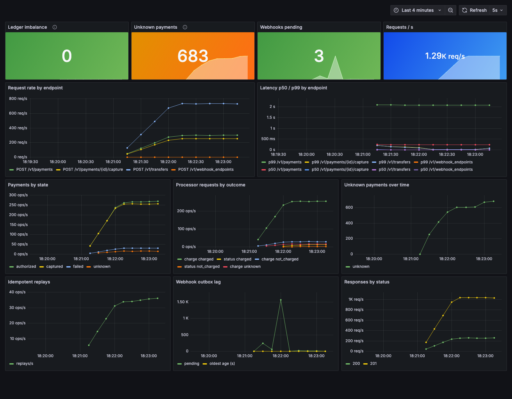

# paycore

A wallet and payments API on a double-entry ledger in Postgres, built to never lose money or
double-charge under concurrency and retries.



*Mid-run at 1,000 ops/s: 1.29K req/s, hundreds of payments `unknown` because the processor is timing
out on purpose, and the ledger imbalance at 0 throughout.*

## Running

Requires Java 21 and Docker.

```
./mvnw test                                        # real Postgres 16 via Testcontainers
docker compose -f deploy/docker-compose.yml up -d  # Postgres (5433) and mock processor (8081)
./mvnw spring-boot:run                             # API on localhost:8080
```

The whole stack, with Prometheus (9090) and the Grafana dashboard (3000):

```
./mvnw package -DskipTests
docker compose -f deploy/docker-compose.yml --profile full up -d --build
```

## API

```
POST /v1/transfers               wallet → wallet
POST /v1/payments                create + authorize a card payment to a merchant
POST /v1/payments/{id}/capture   (also /cancel, /refund)
GET  /v1/payments/{id}
GET  /v1/wallets/{id}/balance
POST /v1/webhook_endpoints       where to send a merchant's payment events
```

Every `POST` requires an `Idempotency-Key` header.

Amounts are integers in minor units (`2500` = 25.00 AED). Errors look like
`{"type": "invalid_request_error", "code": "insufficient_funds", "message": "..."}`.

## Guarantees

- **Balanced ledger:** every journal entry's postings sum to zero, and cached balances always equal
  the sum of their postings.
- **Append-only history:** a trigger rejects edits and deletes on ledger tables. Mistakes are fixed
  with reversing entries.
- **No overdrafts:** balance rows are locked (`SELECT ... FOR UPDATE`) in account-id order, which
  also prevents deadlocks. A `CHECK` constraint backs up the application check.
- **Payments follow a state machine:** `created → authorized → captured → refunded` (or `canceled`,
  `failed`, `unknown`). Illegal moves return `409`, and a version column stops concurrent captures.
  The processor is never called inside a database transaction.
- **Timeouts never double-charge:** a payment whose processor call times out becomes `unknown`. A
  background job then asks the processor about that exact charge (by a reference we chose) and records
  the real outcome once. It never re-sends the charge.
- **No lost webhooks:** every payment change writes its event to an `outbox` table in the same
  transaction. A dispatcher claims events with `FOR UPDATE SKIP LOCKED` and delivers them signed
  (HMAC-SHA256), retrying with exponential backoff until delivered or marked `dead`. Delivery is
  at-least-once; receivers dedupe on the event id.
- **Safe retries:** the same `Idempotency-Key` replays the saved response without moving money again.
  The key's primary key makes concurrent duplicates safe. Reusing a key for a different request
  returns `422`, and retrying while the first is still running returns `409`.

## Load test results

`loadtest/script.js` (k6) mixes 70% wallet transfers with 30% card payments plus captures, and
retries 5% of transfers with the same idempotency key. The merchant has a webhook endpoint
(`loadtest/WebhookSink.java`), so every payment change is also delivered through the outbox.
Afterwards it checks that `ledger_imbalance` is 0.

These runs used a MacBook Air M4 (10 cores, 24 GB), with the app, Postgres and the mock processor in
Docker and k6 on the same machine:

| Target load | Requests/s | Transfer p50 / p99 | Capture p99 | Payment p99 | Checks passed | Ledger imbalance |
|---|---|---|---|---|---|---|
| 200 ops/s, 2 min | 258 | 1.6 ms / 14.7 ms | – | 2 s* | 100% | 0 |
| 500 ops/s, 1 min | 645 | 1.1 ms / 32.9 ms | 27.4 ms | 2 s* | 100% | 0 |
| **1,000 ops/s, 1 min, with webhooks** | **1,287** | **1.0 ms / 25.6 ms** | **25.0 ms** | 2 s* | 100% | 0 |
| 2,000 ops/s, 1 min | ~1,990 (saturated) | 407 ms / 687 ms | 744 ms | 2.5 s | 100% | 0 |

\* The mock processor answers in 200 ms (payment p50 is about 210 ms), and it deliberately times out on 5%
of charges. Those payments wait out the 2 s timeout, come back `unknown`, and are resolved later by the
status-check job. On the dashboard that's the unknown-payments spike draining back to 0.

With webhooks on, the outbox recorded 132,739 events and the receiver got 132,739. None were lost,
none were retried, and there were no duplicates. The other rows were measured before the webhook
receiver was added.

At 2,000 ops/s the stack saturates. Latency climbs and k6 drops about a quarter of the planned
operations, but every response is still correct and the ledger still balances. The likely limit is the
default pool of 10 database connections.

## Tests

- `ConcurrentTransfersTest`: 1,000 concurrent transfers from one wallet never overdraw or deadlock.
- `DuplicateRequestsTest`: 50 concurrent requests with one idempotency key charge exactly once.
- `ProcessorTimeoutTest`: the processor charges but times out. The payment goes `unknown`, resolves to
  `authorized`, and the customer is charged exactly once.
- `WebhookDeliveryTest`: the receiver goes down while 20 events queue up. Once it's back, all 20
  arrive, correctly signed.
- `PaymentLifecycleTest`: authorize, capture, refund, cancel, declines, illegal transitions.
- `LedgerPropertyTest`: random sequences of transfers, payments, captures, refunds and cancels keep
  every invariant after every step.
- Plus unit and integration tests for `Money`, journal entries, the state machine, webhook signatures,
  the ledger, the API and idempotency.
